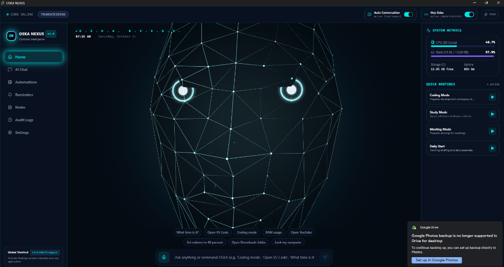
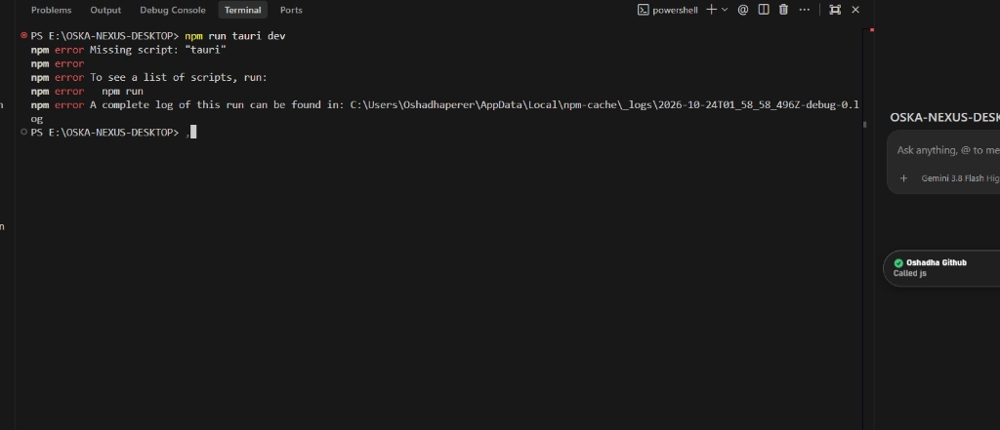
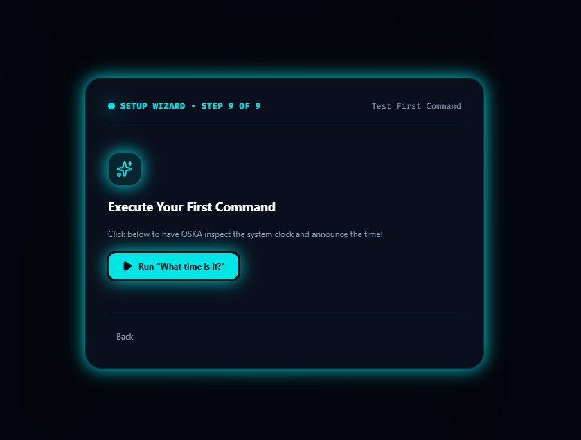

<div align="center">

# 🌌 OSKA NEXUS
### *Obsidian Intelligence — Your Personal Desktop Intelligence*

[](https://github.com/cit-24-01-0476-maker/oska_nexus_exe)
[](https://tauri.app)
[](https://react.dev)
[](https://threejs.org)
[](https://python.org)
[](LICENSE)

<br/>



<br/>
<br/>

**OSKA NEXUS** is a next-generation Windows AI desktop assistant engineered with **Tauri 2 (Rust)**, **React 19**, **Three.js**, and **Python**. It features a live **3D holographic wireframe AI face**, natural **bilingual voice interaction (Sinhala & English)**, and **complete Windows desktop automation** to control your PC hands-free.

[Download Installer](#-downloads--installers) • [Key Features](#-key-features) • [Voice Commands](#-bilingual-desktop-commands) • [Architecture](#-system-architecture) • [Developer Setup](#-developer-setup)

</div>

---

<br/>

<div align="center">
  
  
</div>

<br/>

---

## ✨ Key Features

### 💎 1. Interactive 3D Holographic AI Face
* Real-time 3D abstract human face rendered via **Three.js** and **React Three Fiber**.
* Cyan illuminated polygonal mesh (`#00E5E5`) with dynamic violet highlights (`#8057E9`).
* Reactive procedural animation states:
  - `IDLE`: Gentle breathing and subtle organic head micro-movements.
  - `WAKE_LISTENING` / `LISTENING`: Heightened mesh brightness and real-time audio waveform responsiveness.
  - `THINKING`: Concentrated violet core light with geometry pulse.
  - `SPEAKING`: Jaw/mouth procedural displacement synchronized with speech audio output.
  - `SUCCESS` & `ERROR`: Atmospheric cyan confirmation burst or amber warning glow.
* GPU-accelerated with low-power mode fallback for optimal laptop battery life.

---

### 🎙️ 2. Natural Bilingual Voice Intelligence (Sinhala & English)
* **Speech-to-Text (STT)**: High-accuracy real-time speech recognition tuned specifically for **Sri Lankan Sinhala (`si-LK`)**, **Singlish**, and **English (`en-US`)**, backed by **Faster-Whisper** for offline fallback.
* **Neural Text-to-Speech (TTS)**: Natural spoken audio using Microsoft Neural Voices (`si-LK-ThiliniNeural` for Sinhala, British/US Neural for English) with offline Windows SAPI5 fallback.
* **Hands-Free Wake Word**: Genuine wake-word detection powered by **Picovoice Porcupine** (*"Hey Oska"*).
* **Continuous Conversation**: Multi-turn voice dialogue without requiring repeated clicks or triggers.

---

### ⚡ 3. Deep Windows Desktop Automation (Full PC Control)
OSKA NEXUS has native system access to automate virtually any everyday task on Windows:

* 📸 **Instant Screenshot**: Capture full-screen snapshots and save automatically to `Pictures\Screenshots`.
* 🪟 **Window Management**: Minimize, maximize, close, switch (`Alt + Tab`), and show desktop (`Win + D`).
* 🌐 **Browser & Tab Controls**: Open new tabs, close active tabs, restore closed tabs (`Ctrl + Shift + T`), and refresh pages.
* ⌨️ **Keyboard & Typing**: Type arbitrary text directly into focused applications, press `Enter`, `Escape`, `Space`, or `Backspace`.
* 📋 **Clipboard Automation**: Copy selection (`Ctrl + C`), paste clipboard (`Ctrl + V`), select all (`Ctrl + A`), and save document (`Ctrl + S`).
* 🖱️ **Mouse Control**: Left click, double click, right click, scroll down, and scroll up.
* 📁 **File & Folder Operations**: Create folders on Desktop or Documents, clean/empty the Windows Recycle Bin silently.
* ⚙️ **Windows Utilities**: One-click voice launch for Task Manager, Control Panel, Device Manager, Wi-Fi Settings, Bluetooth Settings, Display Settings, and Windows Update.
* 🎵 **Media & YouTube**: Open YouTube, search videos/songs, and toggle system media playback (`Play` / `Pause`).

---

### 🧠 4. Modular Multi-LLM Intelligence Matrix
* **Offline Local Intelligence**: Fast deterministic rules engine executing commands in <50ms with zero network dependency.
* **Cloud & Local LLM Support**:
  - **Google Gemini** (Gemini 2.5 / Flash-Lite / Pro)
  - **Ollama** (Local Llama 3, Mistral, Gemma offline models)
  - **xAI Grok** (Grok 4.7 / Grok Vision)
  - **OpenAI** (GPT-4o / GPT-4o-mini)
* **DuckDuckGo Web Intelligence**: Live real-time web knowledge lookup when offline without API keys.

---

## 🗣️ Bilingual Desktop Commands

OSKA NEXUS natively understands commands in **Sinhala**, **Singlish**, and **English**:

| Category | Sinhala / Singlish Voice Command | English Voice Command | Action Executed |
| :--- | :--- | :--- | :--- |
| **Screenshot** | *"Screenshot එකක් ගන්න"* / *"screenshot ganna"* | *"Take a screenshot"* / *"Capture screen"* | Saves full screen to `Pictures\Screenshots` |
| **Desktop** | *"Desktop එක පෙන්වන්න"* / *"desktop eka pennanna"* | *"Show desktop"* / *"Minimize all"* | Toggles Windows desktop (`Win + D`) |
| **Window Minimize** | *"Window එක minimize කරන්න"* / *"minimize karanna"* | *"Minimize window"* / *"Minimize active window"* | Minimizes active window (`Win + Down`) |
| **Window Maximize** | *"Window එක maximize කරන්න"* / *"fullscreen karanna"* | *"Maximize window"* / *"Full screen"* | Maximizes active window (`Win + Up`) |
| **Close Window** | *"Window එක වහන්න"* / *"මේක වහන්න"* / *"close karanna"* | *"Close window"* / *"Close this application"* | Closes active window (`Alt + F4`) |
| **Switch Window** | *"Window එක මාරු කරන්න"* / *"switch window"* | *"Switch window"* / *"Alt tab"* | Switches to next window (`Alt + Tab`) |
| **New Tab** | *"අලුත් ටැබ් එකක් අරින්න"* / *"new tab ekak"* | *"Open new tab"* / *"Create tab"* | Opens new browser tab (`Ctrl + T`) |
| **Close Tab** | *"මේ ටැබ් එක වහන්න"* / *"tab eka wahanna"* | *"Close tab"* / *"Close this tab"* | Closes active tab (`Ctrl + W`) |
| **Restore Tab** | *"කලින් ටැබ් එක ගන්න"* / *"reopen tab"* | *"Reopen closed tab"* / *"Restore tab"* | Reopens closed tab (`Ctrl + Shift + T`) |
| **Refresh Page** | *"පේජ් එක refresh කරන්න"* / *"reload karanna"* | *"Refresh page"* / *"Reload"* | Reloads current page (`F5`) |
| **Typing** | *"Type කරන්න [text]"* / *"ලියන්න [text]"* | *"Type [text]"* / *"Write [text]"* | Simulates native keyboard typing |
| **Key Press** | *"Enter ඔබන්න"* / *"escape obanna"* | *"Press Enter"* / *"Hit Escape"* | Fires native Windows key press |
| **Clipboard** | *"මේක copy කරන්න"* / *"paste karanna"* | *"Copy selection"* / *"Paste here"* | Clipboard copy / paste (`Ctrl+C` / `Ctrl+V`) |
| **Select All & Save** | *"ඔක්කොම select කරන්න"* / *"save karanna"* | *"Select all"* / *"Save file"* | Highlight all (`Ctrl+A`) / Save (`Ctrl+S`) |
| **Recycle Bin** | *"Recycle Bin එක හිස් කරන්න"* / *"empty recycle bin"* | *"Empty recycle bin"* / *"Clean trash"* | Empties Windows Recycle Bin silently |
| **Create Folder** | *"Desktop එකේ [Name] folder එකක් හදන්න"* | *"Create folder [Name] on Desktop"* | Creates directory in Windows Desktop |
| **YouTube** | *"YouTube open කරන්න"* / *"YouTube එකේ සිංදු play කරන්න"* | *"Open YouTube"* / *"Search YouTube for [query]"* | Opens YouTube with instant query playback |
| **System Utilities** | *"Task Manager අරින්න"* / *"WiFi settings"* | *"Open Task Manager"* / *"Network settings"* | Launches Windows system utilities |
| **Audio Volume** | *"Volume 50 කරන්න"* / *"සද්දෙ වැඩි කරන්න"* | *"Set volume to 50%"* / *"Turn volume up"* | Adjusts Windows master audio endpoint |
| **System Telemetry** | *"RAM එක කීයද?"* / *"CPU usage එක බලන්න"* | *"How much RAM is used?"* / *"CPU stats"* | Reads live hardware telemetry metrics |

---

## 🏗️ System Architecture

```
+---------------------------------------------------------------------------------------+
|                               TAURI 2.0 (RUST DESKTOP SHELL)                          |
|                                                                                       |
|  +-------------------------------------+    +--------------------------------------+  |
|  |       Main Dashboard Window         |    |      Floating HUD Assistant          |  |
|  |  - React 19 + TypeScript + Tailwind |    |  - Transparent Always-On-Top Window  |  |
|  |  - Three.js 3D Holographic AI Face  |    |  - Real-time Audio Waveform HUD      |  |
|  +-------------------------------------+    +--------------------------------------+  |
|  |  - System Tray: Minimize to Tray, Quick Launch, Full Terminate                     |  |
|  |  - Global Hotkeys: Ctrl + Shift + Space for instant activation                     |  |
|  |  - Sidecar Process Supervisor: Managed Python lifecycle & stdio IPC                |  |
+--+------------------------------------------------------------------------------------+
                                      | Local Authenticated IPC (127.0.0.1:8765)
                                      v
+---------------------------------------------------------------------------------------+
|                              PYTHON 3.11+ CORE BACKEND                                |
|                                                                                       |
|  +------------------------------------+   +----------------------------------------+  |
|  | Voice & Audio Pipeline             |   | Desktop Automation Engine (Win32)      |  |
|  | - SoundDevice RMS Real-time Audio  |   | - Native GDI BitBlt Screen Capture     |  |
|  | - Google Speech (si-LK Sinhala)    |   | - PyAutoGUI Windows Control            |  |
|  | - Faster-Whisper Local Fallback    |   | - Window & Browser Tab Management      |  |
|  | - Microsoft Edge Neural TTS        |   | - Native Keyboard & Mouse Simulation   |  |
|  | - Picovoice Porcupine Wake Word    |   | - Windows Shell & Utility APIs         |  |
|  +------------------------------------+   +----------------------------------------+  |
|                                                                                       |
|  +------------------------------------+   +----------------------------------------+  |
|  | SQLite Local Memory & Audit Log    |   | Multi-LLM Provider Matrix              |  |
|  | - Settings, Chat History, Notes    |   | - Google Gemini, Ollama, Grok, OpenAI  |  |
|  | - Scheduled Reminders Engine       |   | - DuckDuckGo Live Knowledge Fallback   |  |
|  +------------------------------------+   +----------------------------------------+  |
+---------------------------------------------------------------------------------------+
```

---

## 📥 Downloads & Installers

Pre-built self-contained Windows installers (no Python or external runtimes required):

| Package Type | File Name | Size | Architecture |
| :--- | :--- | :--- | :--- |
| **Windows NSIS Installer** *(Recommended)* | [`OSKA NEXUS_1.1.2_x64-setup.exe`](https://github.com/cit-24-01-0476-maker/oska_nexus_exe/releases) | `153.89 MB` | Windows 10 / 11 (x64) |
| **Windows MSI Installer** | [`OSKA NEXUS_1.1.2_x64_en-US.msi`](https://github.com/cit-24-01-0476-maker/oska_nexus_exe/releases) | `155.04 MB` | Windows 10 / 11 (x64) |
| **Portable Standalone Executable** | [`oska-nexus.exe`](https://github.com/cit-24-01-0476-maker/oska_nexus_exe/releases) | `Standalone` | Windows 10 / 11 (x64) |

---

## 💻 Developer Setup

### Prerequisites
* **Windows 10 / 11 (64-bit)**
* **Node.js**: v20+ (`npm`)
* **Rust**: 1.80+ (`cargo`)
* **Python**: 3.11+

### 1. Clone Repository
```powershell
git clone https://github.com/cit-24-01-0476-maker/oska_nexus_exe.git
cd oska_nexus_exe
```

### 2. Install Frontend Dependencies
```powershell
npm install
```

### 3. Setup Python Virtual Environment
```powershell
python -m venv .venv
.\.venv\Scripts\pip install -r python-backend/requirements-lock.txt
```

### 4. Run in Development Mode
```powershell
npx tauri dev
```

### 5. Build Release Installers
```powershell
# Build packaged backend and self-contained installer
npm run package:backend
npx tauri build
```
Compiled installers will be placed in `src-tauri/target/release/bundle/nsis/` and `src-tauri/target/release/bundle/msi/`.

---

## 🛡️ Security & Privacy

* **Local-First Audio Processing**: Audio is processed exclusively on-device during wake-word listening. Audio streaming only occurs when the microphone indicator is visibly active.
* **Safe Power Actions**: Dangerous actions (such as System Restart or Shutdown) require explicit visual modal confirmation before execution.
* **Sandboxed Sidecar IPC**: Backend API endpoints run on loopback (`127.0.0.1`) and are strictly non-public.
* **Credential Protection**: API keys and Porcupine tokens are stored locally on the user's machine.

---

## 📄 License

This project is licensed under the [MIT License](LICENSE) — Developed by **OSKA TECH**.

---

<div align="center">
  <sub>Built with ❤️ by <b>OSKA TECH</b> • <i>"Your Personal Desktop Intelligence"</i></sub>
</div>
